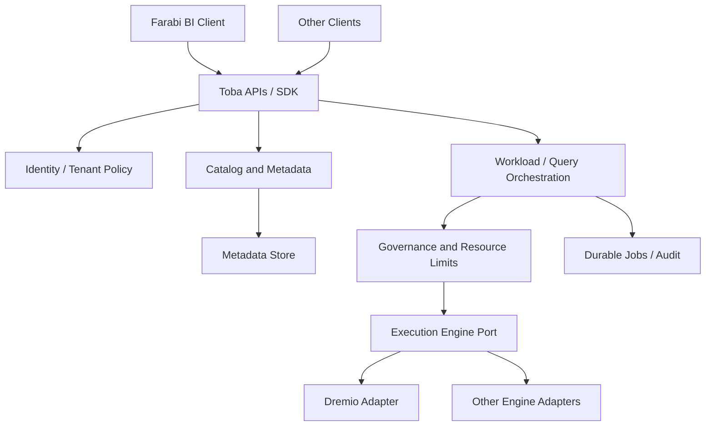
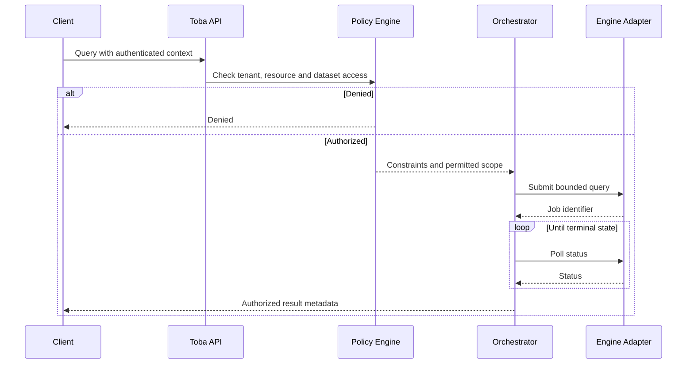
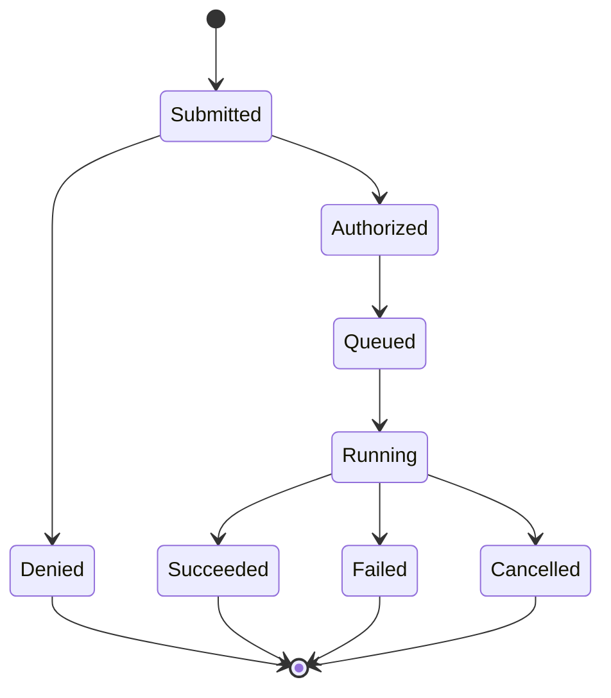

# Toba Architecture Blueprints

> Target architecture. Toba is an independent, engine-agnostic, governed lakehouse control plane. Farabi is a client.

## Logical architecture

## Query execution sequence

## Job lifecycle

## Architectural rules

- No mandatory dependency on Farabi or any single execution engine.
- Tenant isolation, data policies, audit and quotas apply before engine dispatch.
- Support retries, cancellation, idempotency and durable job reconciliation.
- Engine adapters translate execution protocols without leaking vendor types into core contracts.
- Integrate identity and tenancy modules through explicit contracts where appropriate.
