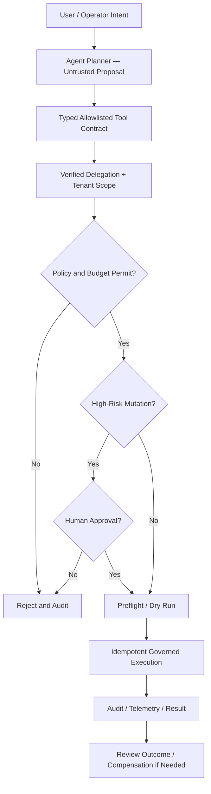

# Governed agent operations — target

**Rule:** Prompts and retrieved data cannot grant privileges. Destructive operations require explicit policy and approval gates. **Status:** target workflow; not an assertion of deployed autonomous operations.
