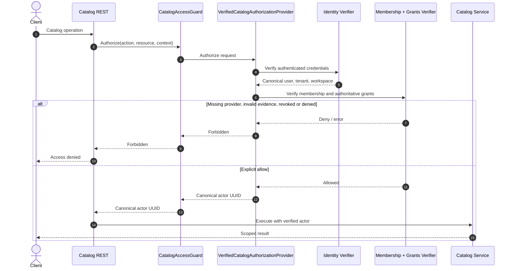

# Catalog authorization and actor provenance — target

**Security rule:** Never accept `X-Actor-Id`, client grants or unverified principal UUIDs as authority. **Status:** composition SPI exists; concrete trusted identity and membership/grant adapters still require implementation and tests.
