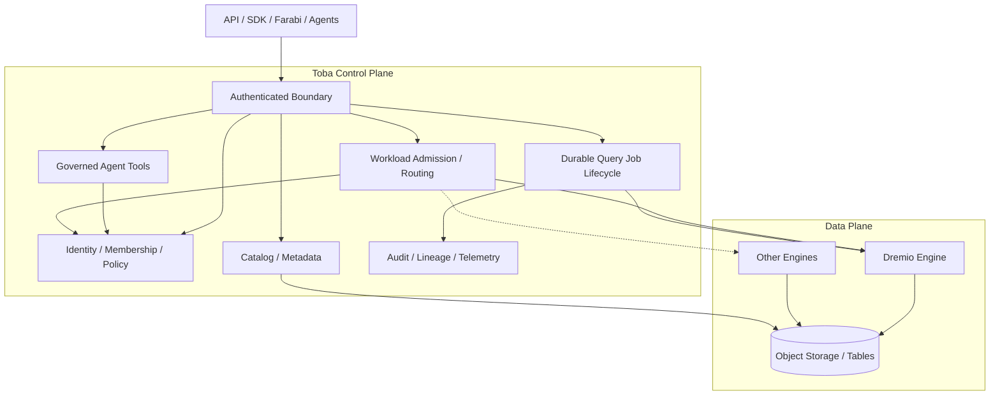

# Control plane and data plane — target

**Trust rule:** Direct client access to engines must be blocked or equivalently policy-enforced at the engine/source boundary. **Status:** logical target, not deployed topology.
