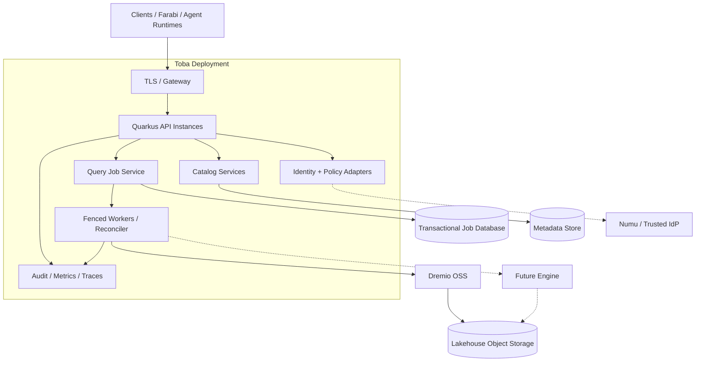

# Deployment topology — reference target

**Deployment boundary:** Workers need idempotent recovery; engines must not expose ungoverned direct paths; credentials use secret management. **Status:** conceptual reference, not a claim of deployed HA.
