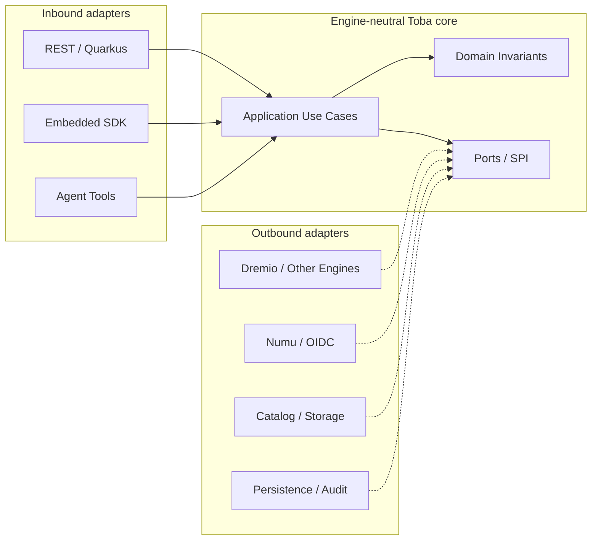

# Hexagonal dependency boundaries — target

**Dependency rule:** Core depends on port abstractions; concrete adapters implement them and are wired by a composition root. Dotted arrows represent implementation-of-port relationships, **not** core imports of adapters. **Status:** desired modularity; enforce with dependency checks.
