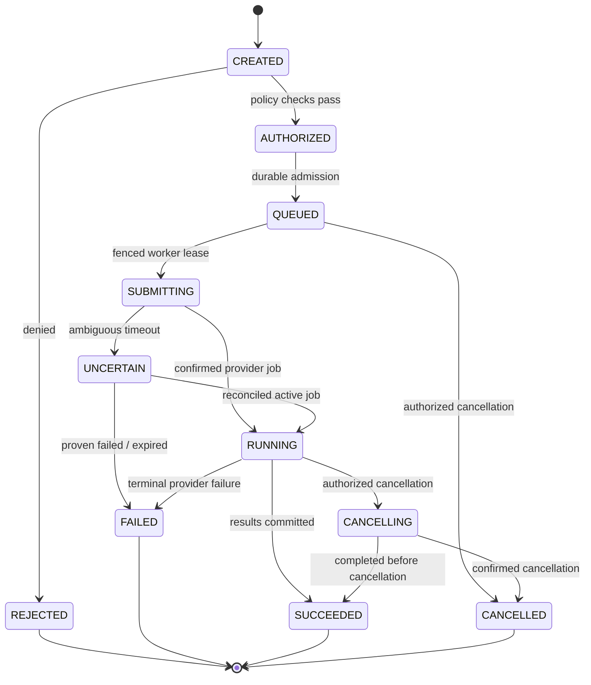

# Toba query job lifecycle — proposed invariant model

**Invariant:** `UNCERTAIN` must not trigger blind duplicate submission. Terminal transitions require idempotency/fencing and audit. **Status:** reference state model; reconcile with actual persistence schema before implementation.
