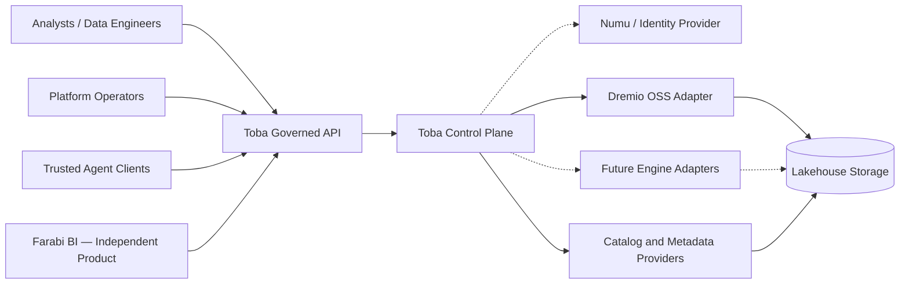

# System context — target

**Ownership:** Toba owns policy decisions and query lifecycle. Farabi owns BI/dashboard experiences; Numu supplies trusted identity evidence when configured. Engines execute physical queries. **Status:** aspirational context; adapter availability must be confirmed independently.
