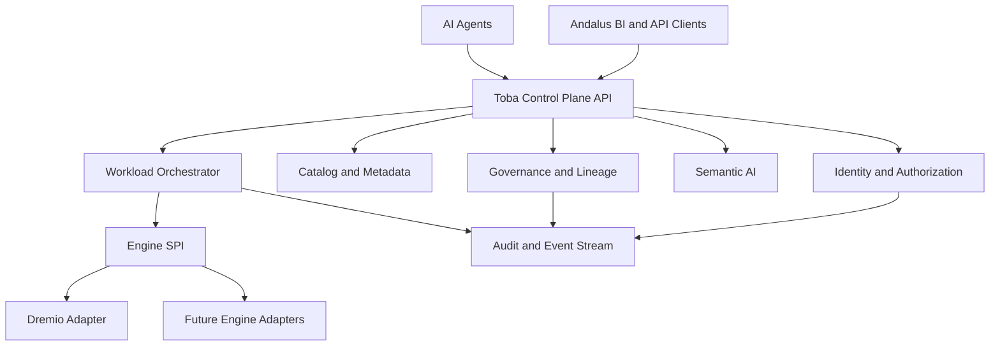
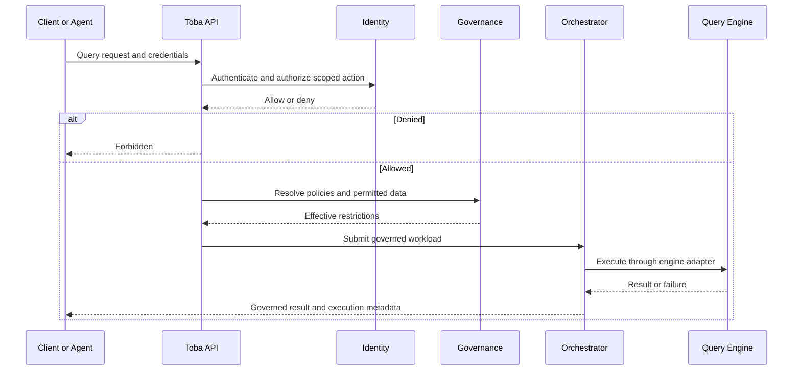

# Toba — Platform Vision and Architecture

Toba is an independent, engine-agnostic, agentic lakehouse control plane. Dremio OSS is its first query engine, not its permanent identity. Andalus BI is an independent consumer of Toba APIs.

## Product boundaries

Toba owns identity, scoped authorization, catalog metadata, governance, audit, workload orchestration, semantic intelligence and agent-facing tools. Query engines own physical query execution. BI clients own dashboards and presentation.

## Target architecture

## Governed query flow

## Engineering principles

1. Deny by default; never trust actor identifiers supplied by clients.
2. Enforce tenant and workspace boundaries at every service entry point and persistence query.
3. Scope role changes precisely: revocation of one assignment must not revoke another scope.
4. Keep engine adapters behind versioned SPI contracts.
5. Audit privileged mutations and query execution with correlation identifiers.
6. Convert agent-generated visualizations into durable, versioned dashboard artifacts in Andalus BI, not in the engine.

## Delivery roadmap

| Phase | Outcome | Acceptance gate |
| --- | --- | --- |
| P0 | Compileable modular foundation and engine SPI | Reactor build and smoke tests pass |
| P1 | Verified identity, RBAC, PAT and service-account controls | Cross-tenant and privilege-escalation tests pass |
| P2 | Catalog lifecycle and connectors | Versioned metadata and idempotent ingestion |
| P3 | Governance enforcement and lineage | Policies affect real execution, not just metadata |
| P4 | Durable workload orchestration | Retries, cancellation, quotas and telemetry |
| P5 | Semantic AI and agent tools | Scoped tool invocation with audit evidence |
| P6 | Andalus BI integration | Prompt-to-visualization-to-static-artifact lifecycle |
| P7 | Multi-engine support | Same contract exercised by a second engine adapter |
| P8 | Enterprise hardening | SLOs, disaster recovery, security review and operations runbooks |

This document is a target-state blueprint, not a claim that these controls are implemented today.
